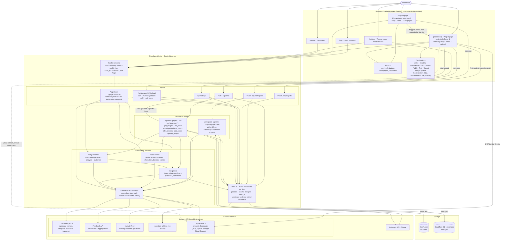
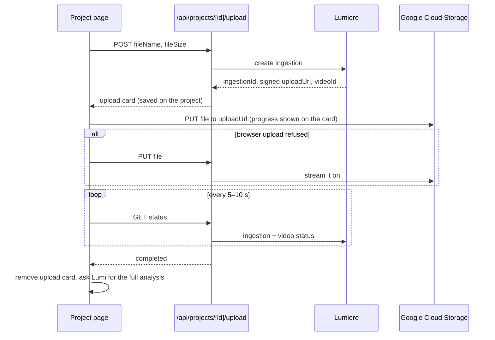

# Iris architecture

Iris is a SvelteKit app deployed on Cloudflare Workers (`iris.<account>.workers.dev`), behind a shared team password.

**How a question flows:** the project page posts the message to `/api/chat`; `agent.ts` runs a Claude tool loop
that reads Lumiere data (analysis, insights, the video library across the user's teams) and returns a short reply
plus card operations; the server merges them into the latest saved project through `store.ts` (retrying if an upload
poll saved in between), and the page applies the operations and focuses the new card. Signed media URLs expire, so
page loads rebuild video and comparison card data; insights come from a six-hour cache.

**How an upload flows:**

