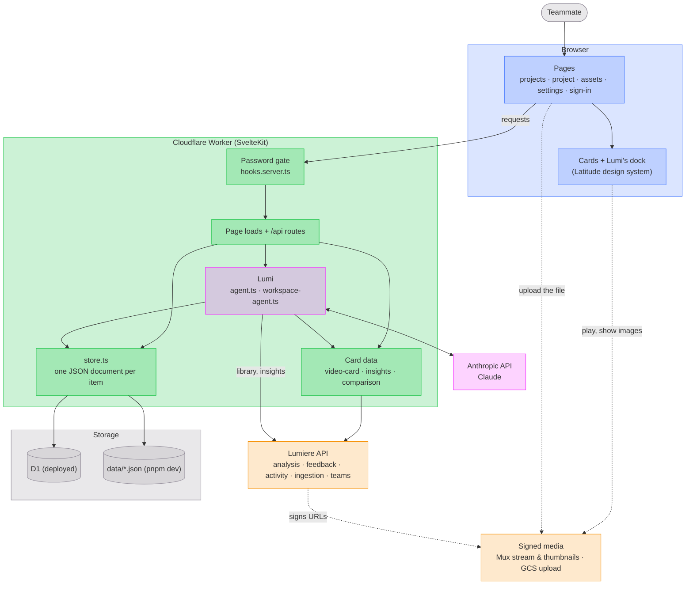
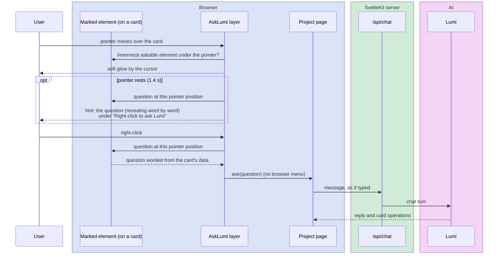
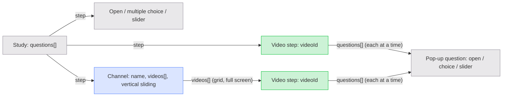
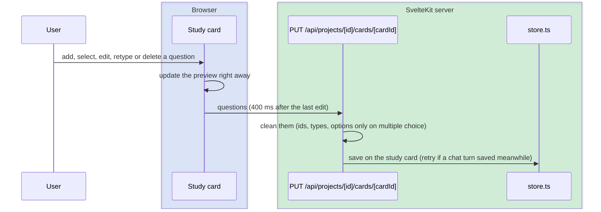
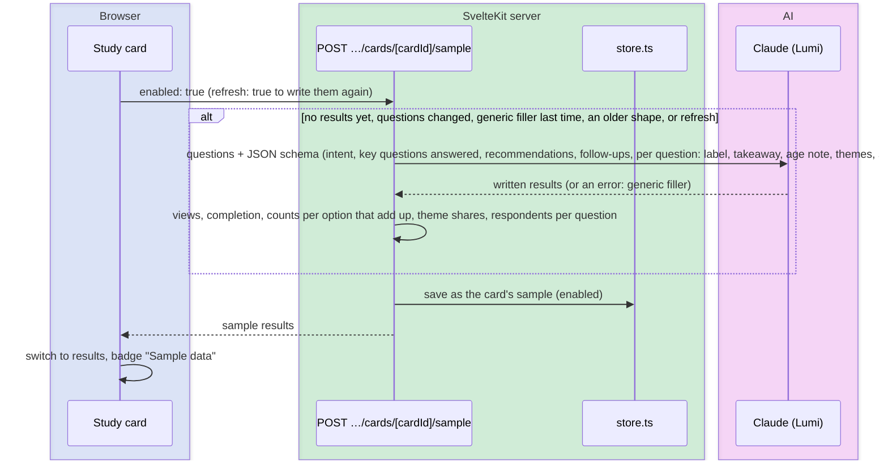
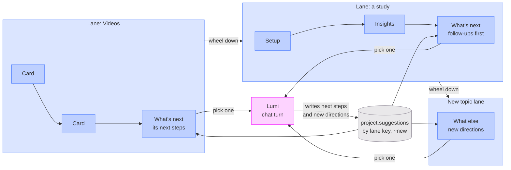
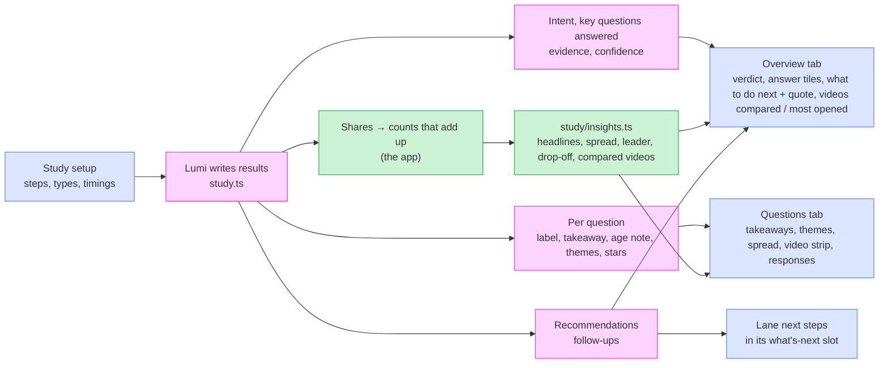
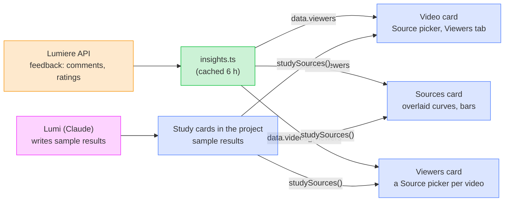
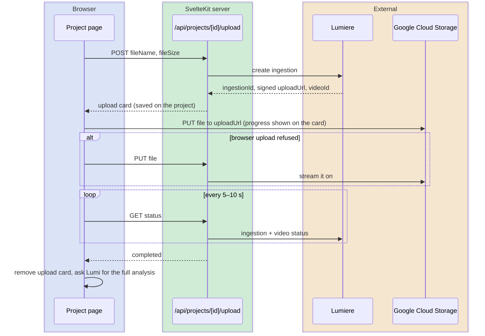

# Iris architecture

Iris is a SvelteKit app deployed on Cloudflare Workers (`iris.<account>.workers.dev`), behind a shared team password.

## Overview



| Part          | Where                                                          | What it does                                                                                                                                                                |
| ------------- | -------------------------------------------------------------- | --------------------------------------------------------------------------------------------------------------------------------------------------------------------------- |
| Pages         | `src/routes`                                                   | Projects page (tiles, Lumi, drop a video → new project), project page (card stack, or topic lanes with Settings → Experimental; focus, uploads), assets, settings, `/login` |
| Cards         | `src/lib/cards`                                                | Video (Overview · Timeline · Viewers tabs), Insights (older cards), Comparison, Sources, List, Quotes, Table, Text, Upload, Study; built from design-system components      |
| Password gate | `src/hooks.server.ts`                                          | Production only: a session cookie from `SITE_PASSWORD`, otherwise `/login`                                                                                                  |
| Lumi          | `src/lib/server/agent.ts`, `workspace-agent.ts`                | Claude tool loops: read analysis and insights, browse the library across the user's teams, add/update/focus cards                                                           |
| Card data     | `src/lib/server/video-card.ts`, `insights.ts`, `comparison.ts` | Fill cards from Lumiere; insights cached for six hours                                                                                                                      |
| Store         | `src/lib/server/store.ts`                                      | Projects, assets, insights, settings as JSON documents; versioned updates retried on conflict                                                                               |

## First visit

Someone new first gets the **tour** (`TOUR_STEPS` in `src/lib/intro.ts`): what Iris does (video analysis, viewer
studies, insights, comparison), scripted through Lumi's own dock on the projects page, with a looping scene
(`TourScene.svelte`) and Back / Next in place of her input (the dock's `below`). It plays until it's finished or
skipped once (the `iris_tour` cookie, so the server leaves the tiles out on a first visit). The first project they
open then plays **How Iris works** (`INTRO_STEPS`, `IntroScene.svelte`, the `iris_intro` cookie): the dock centred
with the cards out of sight, moving down as they appear when it ends. Then they're
greeted by Lumi on the projects page instead of the usual suggestions. The welcome is client-side (no
model call) and remembered per device (`iris.welcomed` in localStorage). Restarting onboarding (Settings, or ⌥⇧O anywhere;
`restartOnboarding`) clears it, deletes the example (`DELETE /api/onboarding`, rebuilt fresh by the projects page load, which makes it whenever it's missing) and
shows the welcome again.

The welcome (or a restart) also starts the **onboarding sequence**, kept in the `iris_onboarding` cookie
(`src/lib/onboarding.ts`) so the server can filter: while it's on, the projects page and Lumi's project list hold only
the example. Leaving the example, or opening any other project (a new draft included), ends it.

The **Getting started** checklist (`src/lib/checklist.svelte.ts`, `GettingStarted.svelte`) is the first tile on the
projects page and a pill in the project page's header. It's kept in the `iris_checklist` cookie, read by the root
layout's server load so the page renders it as the browser has it. Steps tick off on the project page, never in the
example:

````mermaid
---
config:
  look: classic
---
flowchart LR
    subgraph page["Project page (not the example)"]
        cards["Cards on screen"]
        dock["Message typed or picked<br/>in Lumi's dock"]
    end
    cards -- "upload card" --> s1["1 · Upload your first video"]
    cards -- "video card" --> s2["2 · Review the analysed video"]
    dock -- "project has a video card" --> s3["3 · Ask a question about it"]
    cards -- "study card" --> s4["4 · Start a study"]
    cards -- "a video card's Viewers tab, a viewers<br/>or sources card, or a study with sample results" --> s5["5 · Review viewer feedback"]
    s1 & s2 & s3 & s4 & s5 --> cookie[("iris_checklist cookie")]
    cookie --> tile["Tile on the projects page"] & pill["Pill in the project header"]

    classDef ui stroke:#4c7dff,fill:#4c7dff33
    classDef storage stroke:#918b98,fill:#918b9833
    class page,cards,dock,tile,pill,s1,s2,s3,s4,s5 ui
    class cookie storage
``` Its first two answers
go straight where they say; anything else is a normal question to Lumi. The example project ("Demo: Inside Out 2" to people) is one shared project
(`id: example`, `src/lib/server/example.ts`) built from the cards captured for the Storybook and saved on its first
visit or on the projects page whenever it's missing, with Lumi's intro already in its conversation.

```mermaid
---
config:
  look: classic
---
flowchart TB
    open(["Opens the projects page"]) --> introSeen{"Tour seen?<br/>(iris_tour cookie)"}
    introSeen -- "no" --> intro["Tour in Lumi's dock:<br/>analysis · studies · insights · comparison"]
    intro -- "Get started · Skip · Escape" --> seen
    introSeen -- "yes" --> seen{"Welcomed on<br/>this device?"}
    seen -- "yes" --> usual["Usual greeting<br/>and suggestions"]
    seen -- "no" --> welcome["Lumi's welcome<br/>with three choices"]
    welcome -- "Show me a demo" --> load["/projects/example<br/>page load"]
    welcome -- "Upload my own video" --> draft["New draft project<br/>(drop a video)"]
    welcome -- "What can you do? / typed" --> lumi["Lumi on the projects page"]
    lumi -- "open_example tool" --> load
    load --> exists{"Example saved?"}
    exists -- "no" --> build["Build from fixture cards:<br/>video · study<br/>+ Lumi's intro"] --> store[("store.ts")]
    exists -- "yes" --> show
    load --> introDue{"First project<br/>opened?"} -- "yes" --> howIris["How Iris works in the centred dock,<br/>then it moves down as the cards appear"]
    store --> show["Cards refreshed from the analysis,<br/>Lumi's intro and three questions"]

    seen -- "no" --> on[["Onboarding on (cookie):<br/>projects page lists only the example"]]
    show -- "leaves the example" --> off[["Onboarding over:<br/>all projects listed"]]
    draft -- "opens" --> off

    classDef ui stroke:#4c7dff,fill:#4c7dff33
    classDef server stroke:#00bd32,fill:#00bd3233
    classDef ai stroke:#f424ff,fill:#f424ff33
    classDef storage stroke:#918b98,fill:#918b9833
    class open,introSeen,intro,seen,usual,welcome,draft,show ui
    class load,exists,build server
    class introDue,howIris ui
    class on,off ui
    class lumi ai
    class store storage
````

## How a question flows

```mermaid
---
config:
  look: classic
---
sequenceDiagram
    box rgba(76,125,255,0.15) Browser
        participant P as Project page
    end
    box rgba(0,189,50,0.15) SvelteKit server
        participant C as /api/chat
        participant S as store.ts
    end
    box rgba(244,36,255,0.15) AI
        participant A as Lumi (agent.ts)
        participant Cl as Claude
    end
    box rgba(247,146,5,0.15) External
        participant L as Lumiere
    end
    P->>C: message
    C->>S: load project
    C->>A: message + project (cards, history)
    loop until Claude stops calling tools
        A->>Cl: system prompt, history, tools
        Cl-->>A: tool calls
        A->>L: get_video, get_entities, get_insights…
        A->>A: show / update / focus card (card data filled from Lumiere)
    end
    Cl-->>A: short reply
    A-->>C: reply + card operations + history
    C->>S: merge into the latest saved project (retry if an upload poll saved meanwhile)
    C-->>P: reply, card operations
    P->>P: apply operations, focus the new card
```

Signed media URLs expire, so page loads rebuild video and comparison card data; insights come from the cache.

## Ask Lumi from a card

Anything on a card can offer Lumi a question about itself. Cards mark elements with
`{@attach askable((e, el) => question)}` (`src/lib/ask-lumi.ts`); the question is worked out from the card's own data
at the right-click, so a chart asks about the moment under the pointer ("Viewers' comments turn negative around 1:00
(in “Meet the New Emotions”) in “Inside Out 2 trailer”. What happened there, and why…?"). The video card's wording
lives in `src/lib/cards/video/questions.ts`. One `AskLumi` layer per page (`src/lib/components/AskLumi.svelte`)
watches the pointer, shows the glow (and, once the pointer rests, a hint with the question it would ask, under a small
"Right-click to ask Lumi"), and on a
right-click hands the question to the page's `ask`, the same path as a typed message. Storybook's card frame has the layer too and shows the question instead of sending it.



## Editing a study

A study's steps are questions (open, multiple choice, slider), videos and channels. A video step holds its own
questions, each with a time, that pop up while it plays. A channel holds videos, which people browse as a grid and
open full screen; each is a video step, with its own pop-up questions. `flatSteps` lists the steps inside a step
right after it: "2.1", "2.2" for a video's questions or a channel's videos, "5.1.1" for a question in a channel's video.



Lumi drafts a study's questions (`show_card` / `update_card` with `questions`); edits made on the card save straight to
the project, without a chat turn. Lumi sees the saved questions on its next turn.



Sharing isn't built yet. **Share → Fake responses** stands in for it: Lumi writes made-up results for the questions
(structured output), including 15–20 answers per open question; the server works out the counts and a matching sample
of respondents per question, and the card shows them as **Sample data**. They're
kept on the card and written again only when the questions change.



## Topic lanes: one step past the cards

With Settings → Experimental → Topic lanes, the project page groups cards by topic (`cards/lanes.ts`): one lane per
topic, its cards in a row, lanes down the page. The wheel (or a swipe) steps a whole lane down or a card along, and
both go one step past the cards. After each lane's last card is its **what's next** slot: Lumi's next steps for that
topic (`cards/suggestions.ts`, written by `server/suggestions.ts` after a turn), each sending itself to Lumi. Below the
last lane is an empty **new topic** lane with ideas for something the project hasn't covered (stored under `~new`, written in
the same call, the projects page's starters until then). Neither is a card: the card map shows one only while you're on it (a white dot), bird's eye leaves them out, and the
project's focused card stays the last one there was.



## What a study's results answer

Sample results answer what the study set out to learn, not just tally it. When Lumi writes them (`sampleResults` in
`study.ts`), she first works out the author's intent from how the study is built (what each video is for, why a
question pops up where it does, what comparing videos or offering a channel says), then answers the two to four
questions behind it, each with its evidence (study questions by id, with the finding there) and how sure the sample
makes it. Per question she names what it measures, sums it up, notes an age band that stood out, and groups open
answers into themes. The app works the counts out so they add up, and the card's numbers come from those counts
(`study/insights.ts`): headline numbers in the study's own terms, a slider's spread, a multiple-choice leader, a
video's stars, a channel's most opened video, where people dropped off, and, when videos are shown one after another,
which did better. Results in the older shape (`version` below 2) are written again the first time the card shows them.



## Viewer data sources

A video's viewer data comes from sources. **Lumiere**: its real viewers, wherever the video was shown (comments and
ratings with their moments, from `insights.ts`, cached for a few hours). And each **study** in the project that shows
the video (a video step, or a video in a channel) and has sample results: its made-up viewers' comments and star
ratings at their moments, and the answers to questions popping up in the video (`viewer-sources.ts`, worked out in the
browser from the project's cards, which the project page shares). The video card switches between them with
**Source**, and its **Viewers** tab shows the chosen one: the sentiment split, answers to the questions asked in the
video (Lumiere's from `insights.ts`; a study's multiple-choice and slider pop-ups, counted from its sample results),
what viewers liked and didn't, and every comment (a study adds its summary). It replaces the separate insights card:
Lumi opens the Viewers tab (`focus_card` / `show_card` with `tab: "viewers"`) instead of adding one. The sources card
lays the sources over each other. The viewers card compares several videos, each with its own
**Source**, along 0–100% of each video so different lengths line up.



## How an upload flows


