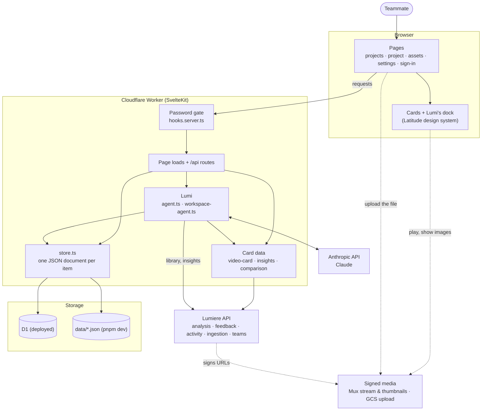
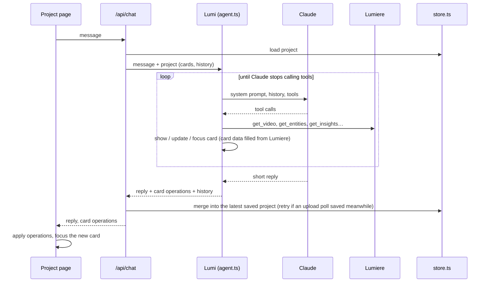
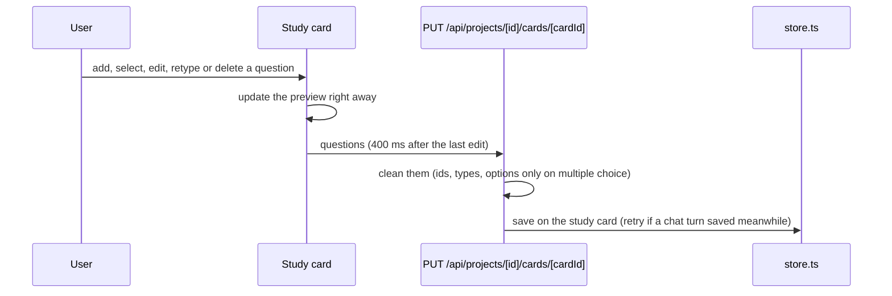
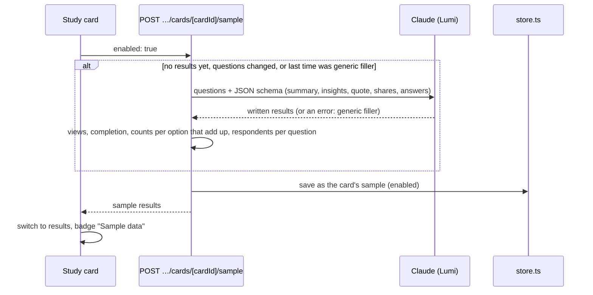
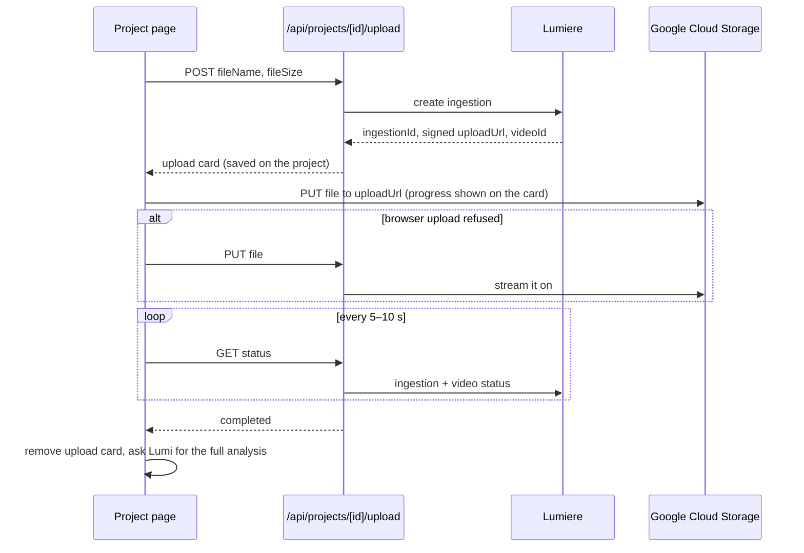

# Iris architecture

Iris is a SvelteKit app deployed on Cloudflare Workers (`iris.<account>.workers.dev`), behind a shared team password.

## Overview

| Part          | Where                                                          | What it does                                                                                                                   |
| ------------- | -------------------------------------------------------------- | ------------------------------------------------------------------------------------------------------------------------------ |
| Pages         | `src/routes`                                                   | Projects page (tiles, Lumi, drop a video → new project), project page (card stack, focus, uploads), assets, settings, `/login` |
| Cards         | `src/lib/cards`                                                | Video, Insights, Comparison, List, Quotes, Table, Text, Upload, Study; built from design-system components                     |
| Password gate | `src/hooks.server.ts`                                          | Production only: a session cookie from `SITE_PASSWORD`, otherwise `/login`                                                     |
| Lumi          | `src/lib/server/agent.ts`, `workspace-agent.ts`                | Claude tool loops: read analysis and insights, browse the library across the user's teams, add/update/focus cards              |
| Card data     | `src/lib/server/video-card.ts`, `insights.ts`, `comparison.ts` | Fill cards from Lumiere; insights cached for six hours                                                                         |
| Store         | `src/lib/server/store.ts`                                      | Projects, assets, insights, settings as JSON documents; versioned updates retried on conflict                                  |

## How a question flows

Signed media URLs expire, so page loads rebuild video and comparison card data; insights come from the cache.

## Editing a study

A study's steps are questions (open, multiple choice, slider) and videos; a video step holds its own questions, each
with a time, that pop up while it plays (`flatSteps` lists them right after it as "2.1", "2.2").

Lumi drafts a study's questions (`show_card` / `update_card` with `questions`); edits made on the card save straight to
the project, without a chat turn. Lumi sees the saved questions on its next turn.

Sharing isn't built yet. **Share → Fake responses** stands in for it: Lumi writes made-up results for the questions
(structured output), including 15–20 answers per open question; the server works out the counts and a matching sample
of respondents per question, and the card shows them as **Sample data**. They're
kept on the card and written again only when the questions change.

## How an upload flows

